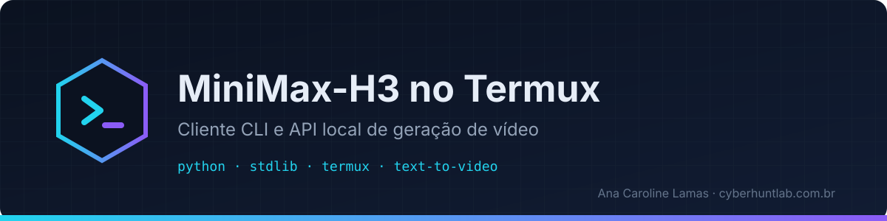

<p align="center"></p>

# MiniMax-H3 no Termux — cliente de geração de vídeo por texto em Python

Script em **Python**, sem dependências externas, para gerar **vídeos a partir de texto** com o serviço **Metaso MiniMax-H3** direto do **Termux** (Android) ou de qualquer terminal. Ele funciona como **linha de comando** (gera e baixa o MP4) ou como **API HTTP local** com autenticação, que repassa os pedidos ao serviço.

> É necessário ter uma chave Metaso válida (normalmente começa com `mk-`); o uso do serviço pode exigir créditos pagos.

## Recursos

- **`setup`**: configuração interativa da URL base e da chave; a chave é digitada sem aparecer na tela e salva em `~/.minimax_h3_config.json`.
- **`generate`**: cria o vídeo a partir de um prompt, acompanha a tarefa e salva `minimax_h3_video.mp4`.
  - duração configurável;
  - resolução `768P` ou `2K`;
  - proporção (`9:16`, `16:9`, `1:1`).
- **`serve`**: API local com token Bearer próprio:
  - `GET /health`;
  - `POST /v1/videos` (criar);
  - `GET /v1/videos/{TASK_ID}` (consultar).
- Usa apenas a biblioteca padrão do Python (`urllib`, `http.server`, `argparse`).

## Instalação

Requisitos: **Python 3.8+**.

```bash
pkg update -y && pkg install python -y      # Termux
git clone https://github.com/ticarollamas-arch/minimax-h3-termux-python.git
cd minimax-h3-termux-python
python minimax_h3.py setup                  # mantenha a URL padrão https://metaso.cn/api/minimax
```

## Como usar

Gerar um vídeo pelo terminal:

```bash
python minimax_h3.py generate "A cinematic shot of a futuristic city at sunrise" --duration 5 --resolution 768P --ratio 9:16
```

Iniciar a API local (padrão `127.0.0.1:8000`):

```bash
python minimax_h3.py serve --host 127.0.0.1 --port 8000
```

Exemplo de requisição:

```bash
curl -X POST http://127.0.0.1:8000/v1/videos \
  -H "Authorization: Bearer SUA_CHAVE_LOCAL" \
  -H "Content-Type: application/json" \
  -d '{"prompt":"A cinematic shot of a futuristic city at sunrise","duration":5,"resolution":"768P","ratio":"9:16"}'
```

## Limitações

- `127.0.0.1` só é acessível no próprio aparelho. Para usar a API a partir de um site, publique-a num servidor (Railway, VPS) com HTTPS; não exponha a porta do Termux.
- O script não cria chaves gratuitas nem substitui o fornecedor. A chave é obtida no painel da conta em [metaso.cn/minimax-h3](https://metaso.cn/minimax-h3).
- Nunca publique a sua chave em mensagens, capturas de tela ou no GitHub.

Guia passo a passo também em [README-PT.md](README-PT.md).

## Tecnologias

Python 3 (biblioteca padrão) · API Metaso MiniMax-H3 · Termux

## Licença

Distribuído sob a licença MIT. Veja [LICENSE](LICENSE).
